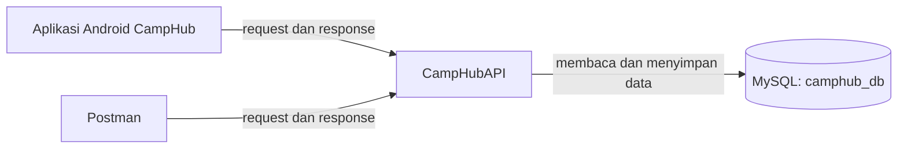
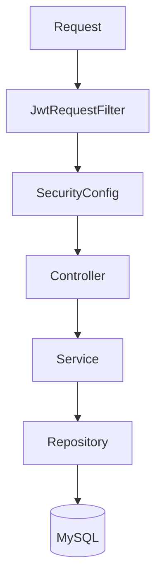
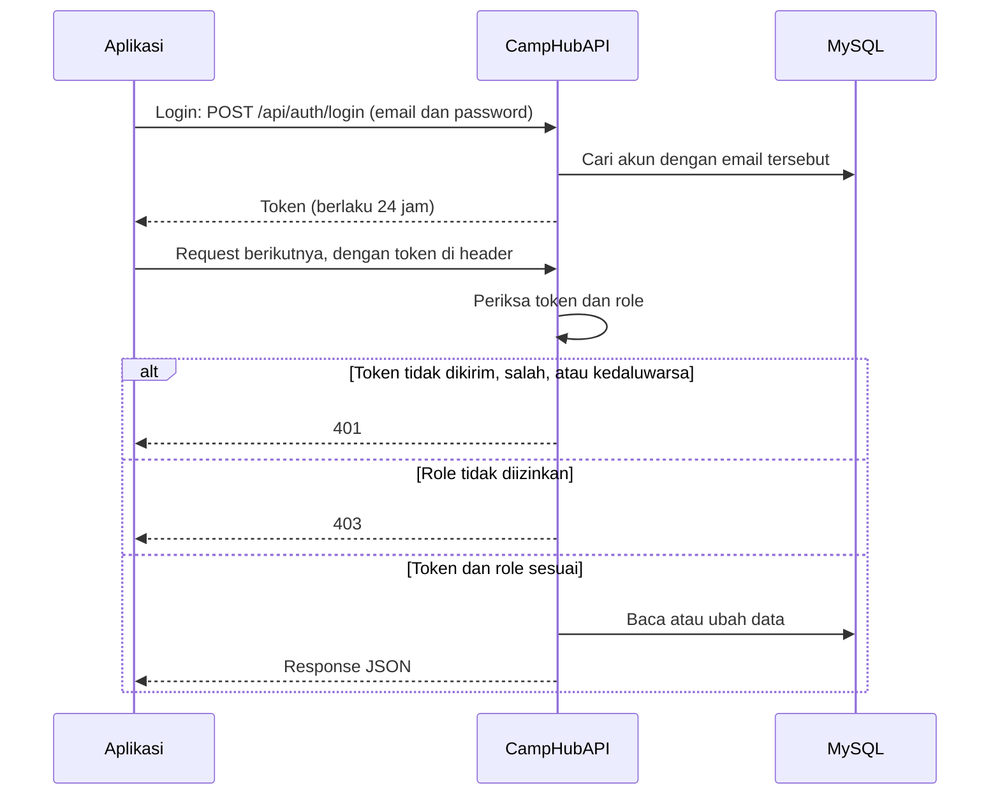
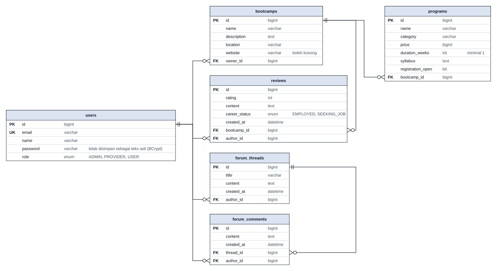

# Arsitektur CampHubAPI

Dokumen ini menjelaskan bagian-bagian backend, alur sebuah request, dan struktur database. Fitur dan cara menjalankan backend ada di [README](../README.md).

## Istilah

| Istilah | Arti |
|---|---|
| Request | Permintaan yang dikirim aplikasi ke backend, misalnya meminta daftar bootcamp |
| Response | Jawaban backend dalam format JSON |
| Token | Kode yang diterima saat register atau login. Dikirim lewat header `Authorization: Bearer <token>` pada request berikutnya. Berlaku 24 jam |
| Role | Jenis akun: USER, PROVIDER, atau ADMIN |
| Entity | Class Kotlin yang mewakili satu tabel database |

## Hubungan antarbagian

- Aplikasi Android dan Postman mengirim request ke backend di port 8080.
- Backend menyimpan data di database MySQL bernama `camphub_db`.
- MySQL dapat dijalankan lewat Docker, XAMPP, Laragon, atau MySQL native.

## Lapisan backend

Setiap request melewati bagian berikut secara berurutan.

| Bagian | Tugas |
|---|---|
| `JwtRequestFilter` | Membaca token dari header request, lalu mencari akun yang sesuai dengan token |
| `SecurityConfig` | Menolak request yang tidak membawa token valid (401) atau yang role-nya tidak diizinkan (403) |
| Controller | Menerima request dan mengembalikan response |
| Service | Logika bisnis, misalnya memastikan data hanya diubah oleh akun yang membuatnya (403 jika bukan) |
| Repository | Akses data ke database (Spring Data JPA) |

Jika terjadi error, backend mengirim response JSON yang berisi `status`, `message`, dan `path`. Formatnya sama untuk semua endpoint.

## Alur login dan request

## Struktur database (ERD)

Cara membaca:
- **PK**: ID unik setiap baris.
- **FK**: kolom yang berisi ID dari tabel lain.
- **UK**: nilainya tidak boleh sama dengan baris lain.
- **Garis** menghubungkan `id` di satu tabel dengan kolom FK di tabel lain. Ujung bergaris dua berarti satu, ujung bercabang dengan lingkaran berarti nol atau banyak. Contoh: satu akun PROVIDER dapat memiliki nol atau banyak bootcamp, dan setiap bootcamp dimiliki tepat satu akun.

## Aturan data

| Aturan | Diterapkan di |
|---|---|
| Satu email hanya untuk satu akun | Database |
| Satu USER hanya dapat menulis satu ulasan untuk setiap bootcamp | `ReviewService` dan database |
| Bootcamp yang masih memiliki program atau ulasan tidak bisa dihapus | `BootcampService` |
| Menghapus pertanyaan ikut menghapus komentarnya | `ForumService` |

Hak akses setiap endpoint ada di [README bagian Endpoint](../README.md#endpoint).
